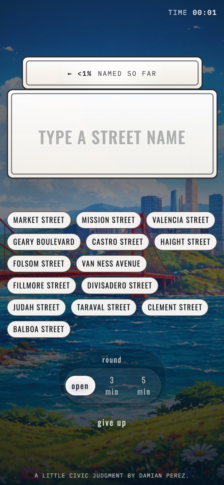

# Name SF

A browser game: how many San Francisco streets can you name? Type street names against the clock and get scored by district.


## What it does

You type SF street names into a big street sign. Correct ones stick as tags and tick up your progress against all 2,219 streets in the dataset; wrong or repeat guesses shake it off. Play open-ended or on a 3 or 5 minute clock, then get a report card that tells you which district you know best and lists everything you named, grouped by district.

## Why I built it

I wanted to see how much of the city I actually knew by name, and a guessing game was a more fun way to find out than staring at a map. It is a small project and it is meant to be one.

## How it works

It is a static page with no backend and no build step to run it. Guessing is a normalized string match: names are lowercased, punctuation stripped, and spelled-out ordinals like "third" are folded to "3rd," so "Third," "3rd," and "third street" all count. Each street carries a district, which is what the end-of-round report groups and ranks by.

The street list itself is prebuilt and committed as `street-data.js`. The scripts in `scripts/` and `build-streets.js` are how it was generated: SF street and right-of-way data becomes the street list, and each street is assigned a district from SF's Analysis Neighborhood boundaries, with a few manual fixes in `scripts/district_overrides.json`. You do not need to run them to play.

## Data sources

Street names and their district assignments are derived from San Francisco open data ([DataSF](https://datasf.org/opendata/)): the street/right-of-way listing and the Analysis Neighborhood boundaries. The processed result is baked into `street-data.js`, so the game runs offline.

## Running it locally

There is nothing to build. Serve the folder with any static server and open `name-sf.html`:

```bash
cd NameSF
python3 -m http.server 8080
```

Then open **http://localhost:8080/name-sf.html**. (Opening the file directly also mostly works; a static server just avoids browser file-access quirks.)

## Screenshots

The end-of-round report card, scored by district:


It plays on mobile too:


