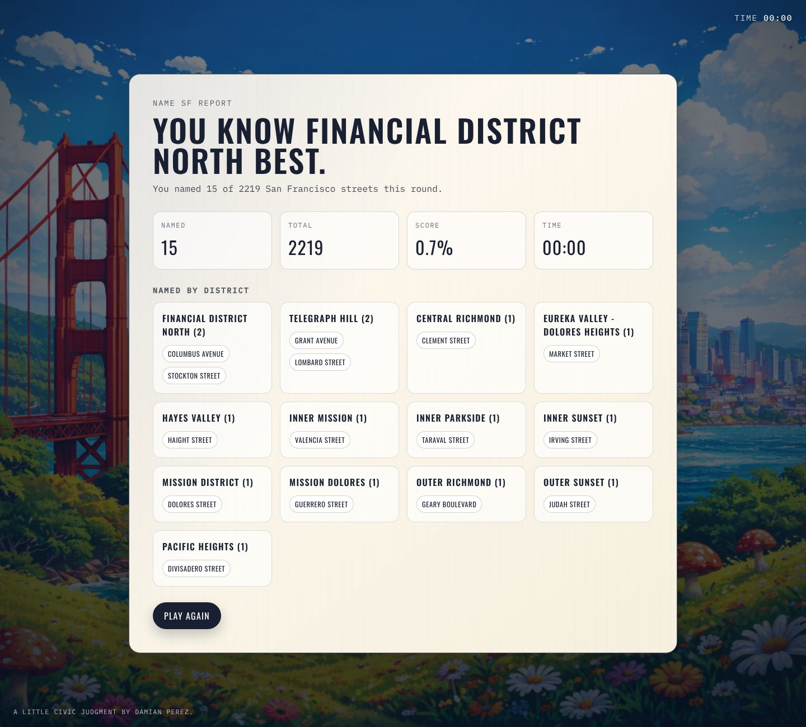

# Name SF

How many San Francisco streets can you name? Type them onto a street sign, then see which neighborhoods you actually know.

I built it to find out how much of the city I knew by name. It is a static page: no backend, no build step, no dependencies.


## How it works

Each guess is normalized before it is looked up, so the spelling of a street doesn't have to match the data:

- **Case and punctuation.** `geary`, `GEARY` and `Geary.` are the same guess. Straight, curly and backtick apostrophes are dropped (`O'Farrell`, `O’Farrell`, `ofarrell`), and hyphens count as spaces (`golden-gate`).
- **Ordinals.** Spelled-out and zero-padded ordinals become numbers: `third`, `03rd` and `3rd` match; so do `twenty-fourth` and `24th`.
- **Street types.** A trailing type is optional and can be abbreviated: `Geary`, `Geary Blvd` and `geary boulevard` all match Geary Boulevard.

A street counts once. Guessing it again under another spelling (`3rd`, then `Third Avenue`) shakes the sign as a miss. One guess can name more than one street when they share a name: `2nd` names both 2nd Avenue and 2nd Drive.

Rounds are open-ended or 3 or 5 minutes; the clock starts on the first guess. When the round ends the report groups everything you named by district, most-named district first, and headlines the one you know best.



The matching and grouping logic lives in `matching.js`, separate from the DOM code in `app.js`, so it can be tested under Node.

## Running it

Serve the folder with any static server and open `name-sf.html`:

```bash
python3 -m http.server 8080
# then open http://localhost:8080/name-sf.html
```

Run the tests (Node 20 or later, nothing to install):

```bash
npm test
```

They cover the normalization rules above, duplicate guesses and district grouping, and check that every street in the committed data can be guessed by its own name. GitHub Actions runs them on every push to `main` and on every pull request.

## Data

The game plays against `street-data.js`: 2,219 streets, each with a district. It was produced by `build-streets.js` (`node build-streets.js`, no dependencies), which:

1. Downloads San Francisco's street names list from DataSF (dataset `6d9h-4u5v`).
2. Keeps conventional street types (Street, Avenue, Boulevard, Drive, Court, Place, Way, Lane, Terrace, Road, Highway and a few others), drops alleys, walks, paths, stairways and plazas, and keeps **one entry per street name**.
3. Looks each street up in a DataSF street centerline dataset and the DataSF neighborhoods dataset (`pty2-tcw4`) to assign a neighborhood, falling back to OpenStreetMap's Nominatim geocoder when DataSF has no match.
4. Writes `streets.json` and `street-data.js` (same content), and lists the 59 streets it could not place in `streets-skipped.json`.

After that build, 65 district names in `street-data.js` were corrected by hand for typos in the source data (for example `Lower Pacfic Heights`), so `street-data.js` and `streets.json` now differ in those rows only.

Known limits of the data:

- Because the build keeps one entry per name, some well-known streets are missing behind a less-known namesake: 2nd, 3rd and 4th Street (the Avenues are in), Kearny Street (Kearny Lane is in) and Stanyan Street (Stanyan Boulevard is in). 1st Street is present. Names with no street type, such as Broadway and The Embarcadero, are not included.
- District names are whatever the sources call them, so neighboring names overlap (`Inner Mission`, `Mission Dolores`, `Mission District`) and some are very local (`Lake`).

`scripts/build_street_data.py` and `scripts/district_overrides.json` are a separate, older pipeline: they build the list from a street CSV and assign districts from the overrides file, writing `Citywide` where there is none. The committed data was not produced by it; `matching.js` still handles its `Citywide` districts and `-` (no street type) suffix. The three `data_sf_*.geojson` files are truncated stubs that neither script reads.

## Status

Finished and playable. The open items are the data gaps above.

## License

MIT. See `LICENSE`.
